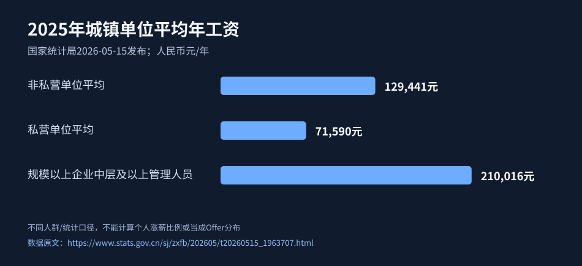
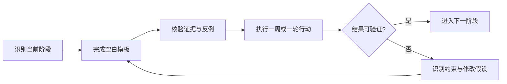

<div align="center">

# 普通人跳槽涨薪保姆级指南

**从找对岗位、写简历、面试到谈薪：完成一次可复盘的社招求职**

**100%免费 · 10章深度教程 · 50项可勾选任务 · 10套SOP · 26份模板 · 20个FAQ · 离线互动网页**

[🚀 从这里开始](START_HERE.md) · [免费互动任务页](index.html) · [完整案例](CASES.md) · [AI提示词](AI_PROMPTS.md) · [问题解答](FAQ.md) · [可核验来源](SOURCES.md)

</div>

> **TL;DR｜一句话**：这是 AI 酋长 Andy 写的免费开源跳槽涨薪指南。适合准备社招跳槽的中国职场人。它把判断该不该跳、岗位与薪酬调查、简历、投递、面试、谈薪、比较 Offer 和安全离职拆成可照做的步骤，含 10 章教程、50 项任务和 26 份模板。
>
> 作者：AI 酋长 Andy（[GitHub @AIPMAndy](https://github.com/AIPMAndy) · [X @AIPMAndy](https://x.com/AIPMAndy) · [metaver.vip](https://metaver.vip/)）

**跳槽涨薪怎么做？** 这份免费指南把一次社招求职拆成可以照着做的步骤：先判断该不该跳，再做岗位和薪酬调查、写简历、投递、面试、谈薪、比较 Offer，最后安全离职。10 章教程、50 项任务、26 份模板，全部免费。

*English: a free step-by-step guide to changing jobs and getting a raise in China: job targeting, resume, interviews, salary negotiation and offer comparison.*

[在线阅读](https://aipmandy.github.io/how-to-job-hop-and-raise-salary/) · [Andy个人官网](https://metaver.vip/) · 微信 **AIPMAndy**

---

## 本版新增：事实与证据直接进入正文

**每个章节都附原始链接、样本/适用范围、观察结论、能执行的动作以及不可外推的边界**。另外新增可检查的来源登记表和真实证据审计，严禁把虚构案例当个人客户成功案例。

- [📚 证据资料库网页版（直接查看原文）](evidence/index.html) · [Markdown原始证据卡片](evidence/SOURCE_CARDS.md)
- [🧭 十章证据映射](evidence/CHAPTER_MAP.md)
- [🔬 对抗式事实审计及证据缺口](evidence/CLAIM_AUDIT.md)
- [📊 机器可读取的来源登记CSV](evidence/source_registry.csv)
- [✍️ 用于补充真正授权案例的采证模板](templates/research-provenance-template.md)


> **一句话解决的问题：** 用岗位样本、真实履历和税前年现金口径，减少无效投递、薪资信息误判与Offer风险。
>
> 适用于中国大陆常见职业语境。没有保证结果的承诺；数字案例均明确标“虚构示例”。证据增强及关键来源核验：**2026-10-12**。当地法律与招聘政策可能变化，个案以官方现行规则与专业意见为准。

**项目页面效果（由实际 HTML 渲染生成）**


## 先看证据：提升简历、搜岗、谈薪到底有没有研究依据？

- **工资必须讲统计口径**：2025年全国城镇非私营单位平均年工资129441元、私营单位71590元，见[国家统计局原文](https://www.stats.gov.cn/sj/zxfb/202605/t20260515_1963707.html)；这些不是特定Offer价格。
- **简历表达有实验证据**：近50万求职者的在线劳动力平台实验，接受算法写作辅助的求职者被雇用比例相对提高8%。来源[NBER](https://www.nber.org/papers/w30886)，不可说成8个百分点。
- **谈薪存在真实实验**：美国科技招聘者样本中，轻量鼓励谈薪干预增加谈判尝试和薪酬收益。见[NBER原文](https://www.nber.org/papers/w33903)，不保证中国求职个体结果。



## 只花3分钟，先选你的入口

| 你现在卡在 | 优先做 | 这周必须拿到 |
|---|---|---|
| 不知道要不要跳槽 | [第00章](guides/00-start.md) | 保底现金对照+风险红线 |
| 海投没回复 | [第01章](guides/01-market.md) + [第02章](guides/02-resume.md) | 30条岗位研究+两版真实简历 |
| 面试多、经常被刷 | [第04章](guides/04-interview.md) | 8张STAR真实故事卡+追问复盘 |
| 已有Offer、担心吃亏 | [第05章](guides/05-negotiate.md) + [第06章](guides/06-compare.md) | 书面条款+薪酬拆分+风险比较 |
| 空窗、转行或城市迁移 | [第09章](guides/09-special.md) | 迁移能力证明+风险替代方案 |

## 先执行这7天

| 天数 | 行动 |
|---|---|
| 第1天 | 算出当前保底税前现金、真实风险底线和可接受岗位 |
| 第2天 | 查10个真实JD，记录来源、职责和薪资口径 |
| 第3天 | 定位主攻岗位，把JD要求映射到本人真实事实 |
| 第4天 | 做两版简历与2张STAR故事卡 |
| 第5天 | 筛选合格岗位，少量精准投递并建立跟踪表 |
| 第6天 | 做一次20分钟模拟面试及追问复盘 |
| 第7天 | 按求职漏斗查掉点，决定下一周的单一改进 |

> **完成标准**：留下合法取得的证据，不是读完、收藏或打钩就算完成。30天是行动实验，不保证拿到Offer或涨薪；竞业及离职争议需要专业法律核验。

## 10章深度行动地图

| 章节 | 读完能够做什么 | 具体行动 |
|---|---|---|
| [00 三分钟判断现在该不该跳](guides/00-start.md) | 跳槽可能提高现金收入，也会带来试用期、稳定性、通勤和福利的不确定性。先看约束。 | 本章5项任务+深入实操、反例、验收 |
| [01 岗位定位与市场薪酬调查](guides/01-market.md) | 薪资范围是多个分布的交集，不能用单一平均工资代替具体Offer。 | 本章5项任务+深入实操、反例、验收 |
| [02 简历：用证据争取面试机会](guides/02-resume.md) | 简历是岗位匹配材料，所有数据与头衔必须真实。 | 本章5项任务+深入实操、反例、验收 |
| [03 投递、内推与求职漏斗](guides/03-pipeline.md) | 用数据优化流程，避免无差别海投。 | 本章5项任务+深入实操、反例、验收 |
| [04 面试：从复述经历到业务决策](guides/04-interview.md) | 面试评估通常围绕岗位能力、证据可信度和协作方式。 | 本章5项任务+深入实操、反例、验收 |
| [05 谈薪：用完整报价和证据谈判](guides/05-negotiate.md) | 谈薪先确认预算区间和薪资组成，绝不靠虚构竞品Offer。 | 本章5项任务+深入实操、反例、验收 |
| [06 比较Offer：现金、确定性与风险](guides/06-compare.md) | 高薪岗位也可能因为激励不确定、成本增加和组织风险而不划算。 | 本章5项任务+深入实操、反例、验收 |
| [07 离职交接与新工作90天](guides/07-exit.md) | 拿到好Offer只是起点，稳定落地需要良好交接和入职验证。 | 本章5项任务+深入实操、反例、验收 |
| [08 30天求职冲刺计划](guides/08-30days.md) | 计划按现有工作时间调整；数量是练习节奏，不代表保证拿到Offer。 | 本章5项任务+深入实操、反例、验收 |
| [09 复杂情况：失业、转行、空窗期与风险](guides/09-special.md) | 特殊案例要考虑现金流、岗位证据和个人处境，不做统一答案。 | 本章5项任务+深入实操、反例、验收 |

## 10套执行SOP：跟着做，不需要先买课

| 保姆级SOP | |
|---|---|
| 1 | [SOP · 判断是否现在跳槽](playbooks/00-stay-or-leave.md) |
| 2 | [SOP · 做30个岗位薪酬采样](playbooks/01-job-market-research.md) |
| 3 | [30个岗位池与两版简历实战](playbooks/01-resume-30positions.md) |
| 4 | [面试到拿Offer：如何发现掉点](playbooks/02-interview-loop.md) |
| 5 | [SOP · 把JD转成可核验简历](playbooks/02-resume-keyword-match.md) |
| 6 | [SOP · 建立求职漏斗与内推行动](playbooks/03-application-pipeline.md) |
| 7 | [两份Offer如何谈、算、选](playbooks/03-offer-negotiation.md) |
| 8 | [SOP · 完成8张STAR故事卡与模拟面试](playbooks/04-star-mock.md) |
| 9 | [SOP · 安全离职与新岗位90天](playbooks/07-exit-and-onboarding.md) |
| 10 | [SOP · 处理空窗期、转行和可疑招聘](playbooks/09-gap-transition-risk.md) |

## 25份可复制空白模板

CSV文件建议用表格软件打开，**每份只含空白栏位**；不得把自己的身份证、工资流水、公司秘密、真实客户资料提交到公开仓库。

| 模板 | 模板 |
|---|---|
| [30-day-plan.csv](templates/30-day-plan.csv) | [achievement-story.md](templates/achievement-story.md) |
| [exit-decision.csv](templates/exit-decision.csv) | [interview-followup.csv](templates/interview-followup.csv) |
| [interview-retro.md](templates/interview-retro.md) | [interview-review.csv](templates/interview-review.csv) |
| [jd-matrix.csv](templates/jd-matrix.csv) | [job-pipeline.csv](templates/job-pipeline.csv) |
| [job-search-30days.md](templates/job-search-30days.md) | [job-target.md](templates/job-target.md) |
| [negotiation-scripts.md](templates/negotiation-scripts.md) | [net-gain-calc.csv](templates/net-gain-calc.csv) |
| [offer-checklist.md](templates/offer-checklist.md) | [offer-comparison.csv](templates/offer-comparison.csv) |
| [offer-comparison.md](templates/offer-comparison.md) | [offer-terms.csv](templates/offer-terms.csv) |
| [onboarding-90days.csv](templates/onboarding-90days.csv) | [pipeline-retro.csv](templates/pipeline-retro.csv) |
| [privacy-security.md](templates/privacy-security.md) | [referral-message.md](templates/referral-message.md) |
| [resume-evidence-map.csv](templates/resume-evidence-map.csv) | [risk-register.csv](templates/risk-register.csv) |
| [salary-benchmark.csv](templates/salary-benchmark.csv) | [story-bank.csv](templates/story-bank.csv) |
| [weekly-funnel.csv](templates/weekly-funnel.csv) |  |

## 两个典型读者的完整演练

- [两则包含输入、操作、算术、交付物和反例的虚构案例](CASES.md)。所有案例均明确标注虚构，**不得用于宣传“我已帮助某客户升职/拿到Offer”**。
- [20个常见疑问](FAQ.md)，包括岗位头衔、简历真实性、薪资口径、劳动合同与隐私。
- [5套AI辅助Prompt](AI_PROMPTS.md)，要求AI只做核对、模拟与改写，禁止臆造岗位经历。

## 免费互动网站：50项任务离线可运行

[直接打开 `index.html`](index.html)。页面包含任务搜索、按章节筛选、打卡与JSON进度导入导出，并提供年度税前现金结构计算器。

- **隐私**：无需登录、API Key、第三方脚本；输入只在当前浏览器处理。浏览器进度由`localStorage`保存；浏览器清理数据可能丢失。
- **离线**：下载ZIP解压后，用浏览器双击`index.html`；所有任务交互无需联网。链接到GitHub和作者官网当然需要联网。
- **开发者**：`data/tasks.json`负责50个动作，`deepdives/`负责每章深入正文，运行`python3 build.py`重建首页与Markdown章节，**不会清空深度内容**；若要同时重建10个静态HTML阅读页，请先运行`python3 -m pip install -r requirements-dev.txt`。仓库已内置生成好的HTML，普通读者无需安装任何依赖。

```bash
python3 build.py
python3 -m unittest discover -s tests -v
```

## 复杂事项先看这里

- **职位与市场**：岗位信息与工资报告只代表对应样本，不代表个人保证收入；请检查时间、城市、职级、奖金性质。
- **劳动合同**：签字费返还、服务期、竞业限制与离职通知需要核对书面约定和现行法律；[最高法2025年司法解释（二）](https://www.court.gov.cn/zixun/xiangqing/472691.html)不能被简化为“竞业都无效”。
- **个人数据**：GitHub Issue、PR、AI聊天和公开讨论中**不提交**身份证、联系方式、合同/工资单原件、客户信息、公司业务秘密。
- **风险**：不支付“保录内推”费用，不制作虚假岗位、虚假绩效、虚假Offer。

## 流程图



## 常见问题 FAQ

### 跳槽涨薪第一步做什么？

先算出当前保底税前现金、真实风险底线和可接受的岗位，再去查 10 个真实 JD。照着上面的“先执行这7天”走一遍就行。

### 跳槽一般能涨多少？

没有适用所有人的通用百分比。要同城、同岗、同级、同口径比较，还要把生活成本和风险算进去。

### 招聘平台上的薪资区间，就是我能拿到的钱吗？

不是。区间可能涵盖不同级别、月数和浮动部分，实际报价还取决于招聘流程和合同。

### 谈薪能不能说手上有别的 Offer？

没有就不要编。有真实的外部机会，可以据实、在合适范围内讨论。

### 投了很多简历没回复，是简历太差吗？

不一定，也可能是岗位冻结、申请的人太多或者不匹配。攒够样本以后再调整变量，用求职漏斗找到掉点。

### 这份指南收费吗？

从章节到模板全部免费，不用登录。更多问题看 [20 个常见问题](FAQ.md)。

## 自愿咨询：什么时候需要人帮你看？

项目从章节到模板均免费。如果你已经执行并明确卡在职级标准、晋升材料、岗位定位、简历证据、面试复盘、谈薪取舍等**个性化判断**，可以自愿向作者寻求职业咨询。

**作者：AI酋长Andy｜微信：AIPMAndy｜[官网](https://metaver.vip/)**。私聊时可备注「跳槽涨薪」，仅描述问题和已经尝试的步骤，不在公开Issue上传个人数据；价格、服务范围、课次、退款与交付在付款前确认。服务**不承诺保晋升、保录用、保涨薪**。详见 [BUSINESS.md](BUSINESS.md)。

## 审核、贡献和使用

- [对抗式审查与明确未验证边界](audit/ADVERSARIAL_REVIEW.md) · [官方与研究来源](SOURCES.md) · [发布SOP](LAUNCH.md) · [内容分发计划](CONTENT_GROWTH.md)。
- [如何贡献校正与新经验](CONTRIBUTING.md)：请附官方来源、适用范围、发布日期和验证日期。不要发布完整付费文章和未经许可的图片。
- **授权**：仓库代码按[MIT](LICENSE)，原创文字与模板建议按[CC BY 4.0](https://creativecommons.org/licenses/by/4.0/deed.zh-hans)署名共享；第三方资料保留其权利。
- **延伸阅读**：[Andy《失业了咋办？保姆级指南》](https://github.com/AIPMAndy/how-to-survive-unemployment)。

*提醒：本仓库不构成个性化法律、税务、薪酬或聘用承诺。*

<!-- andy-author-card:start -->
## 作者 / About the author

**AI 酋长 Andy（Andy Liu，GitHub/X @AIPMAndy）**：前腾讯/百度 AI 产品专家，大模型独角兽前 VP，现专注 AI + 产品方法论创业。

可以找我聊求职咨询、AI 增长和副业陪跑，服务范围和费用先沟通确认。

微信 `AIPMAndy`（备注「跳槽涨薪」）· [X @AIPMAndy](https://x.com/AIPMAndy) · [Telegram @AIPMAndy](https://t.me/AIPMAndy) · [个人官网 metaver.vip](https://metaver.vip/) · [Grok Bot 中文攻略](https://aipmandy.github.io/grok-bot-handbook/)

*AI Chief Andy (Andy Liu, @AIPMAndy on GitHub and X) is a former Tencent and Baidu AI product expert and former VP at an LLM unicorn, now a serial entrepreneur focused on AI and product methodology.*

### 作者的其他项目

- [失业自救开源手册](https://github.com/AIPMAndy/how-to-survive-unemployment)：失业怎么办、被裁员后怎么办：补偿、失业金、医保社保和现金流
- [一个人靠 AI 赚钱](https://github.com/AIPMAndy/one-person-ai-income-guide)：验证需求、第一笔收款、交付与复购，附 30 天计划
- [中国人赚美金](https://github.com/AIPMAndy/how-to-earn-usd-from-china)：8 种海外收入路线、获客、报价、收款与税务
- [Grok Bot 中文攻略](https://github.com/AIPMAndy/grok-bot-handbook)：Grok Bot / AI Agent 中文教程，26 章加 40 套任务指令

<!-- andy-author-card:end -->
